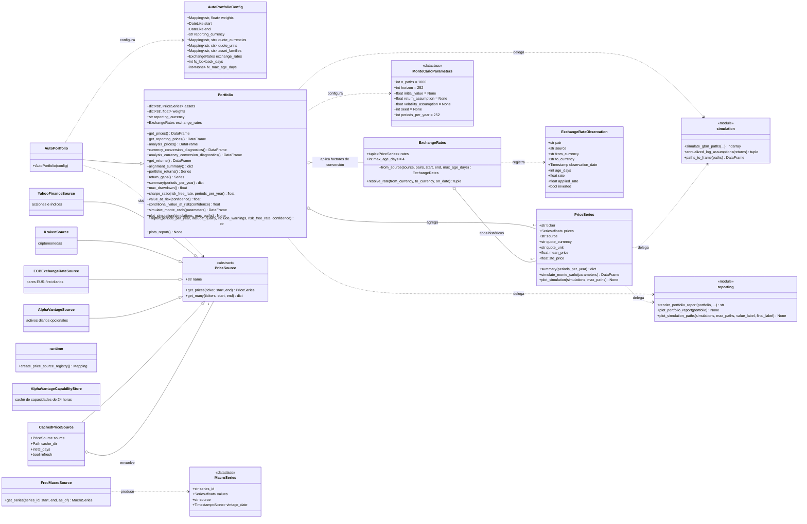
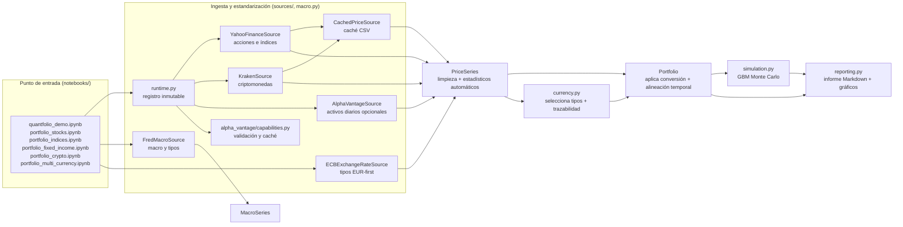

# Arquitectura de Quantfolio

Diagramas de la estructura de clases, las dependencias entre módulos y el flujo de datos del sistema. Los
diagramas están escritos en **Mermaid** (UML equivalente, renderizable directamente en GitHub); pueden editarse en
[FossFLOW](https://github.com/ai-8/fossflow), en [mermaid.live](https://mermaid.live) o en cualquier editor con
soporte de diagramas Mermaid.

## Diagrama de clases (UML)

**Lectura del diagrama.** `PriceSource` es el contrato común de la capa de ingesta: los proveedores concretos
(Yahoo Finance, Kraken, Alpha Vantage y ECB) lo implementan y `CachedPriceSource` lo decora sobre cualquier otro proveedor, de forma
que la capa de análisis nunca depende de una API concreta. `PriceSeries` y `Portfolio` son las DataClasses del
modelo; `MonteCarloParameters` concentra la parametrización del motor `simulation.py`, y `reporting.py` contiene
los helpers de Markdown y gráficos que los métodos públicos delegan. `FredMacroSource`/`MacroSeries` cubren la
tipología de datos adicional (macroeconomía y tipos de interés): las descargas pasan por el endpoint de archivo de
ALFRED, cada `MacroSeries` registra en `vintage_date` el vintage del que proceden sus valores y `as_of` recupera los
valores punto-en-el-tiempo publicados hasta una fecha; si el vintage servido no coincide con el solicitado, la
descarga falla con `ValueError` en lugar de etiquetar mal la serie.

`AutoPortfolioConfig` permite declarar `quote_currencies` y `quote_units` para completar la procedencia
monetaria, y `asset_families` para resolver tickers ambiguos. Los tipos pueden aportarse manualmente en
`exchange_rates` o descargarse automáticamente cuando se omite esa colección. `max_age_days` limita la
antigüedad de cada observación; `fx_max_age_days` fija el valor efectivo para una descarga y debe coincidir
con la colección cuando ambos se proporcionan. `Portfolio.get_reporting_prices()` y
`currency_conversion_diagnostics()` conservan la vista estricta sobre la unión de calendarios;
`analysis_prices()` y `analysis_currency_conversion_diagnostics()` limitan la conversión y su traza a las fechas
comunes usadas por las métricas y el informe.

## Flujo del sistema

**Flujo típico.** Los cuadernos crean los proveedores y descargan las series (en lotes con `get_many()`, con
caché opcional). Cada proveedor normaliza su respuesta en `PriceSeries`, que limpia los datos y calcula sus
estadísticos al construirse. Con varias series se instancia `Portfolio`, que valida y normaliza los pesos y alinea
los calendarios. Si se declara una divisa de reporte, `currency.py` selecciona tipos históricos directos, inversos o
cruzados por EUR y registra cada tramo utilizado. `Portfolio` aplica a los precios los factores seleccionados por
`currency.py` antes del análisis. Sobre la cartera se calculan métricas, se genera el informe y los gráficos
(`reporting.py`) y se lanza la simulación Monte Carlo
(`simulation.py`), cuyos resultados también se visualizan. Los cuadernos
`portfolio_*.ipynb` aíslan cada clase de activo; `quantfolio_demo.ipynb` recorre el toolkit completo y compara las
cuatro clases en una cartera diversificada.

## Estructura de módulos

| Módulo | Responsabilidad |
|---|---|
| `quantfolio.models` | `PriceSeries` (limpieza, estadísticos y metadatos de cotización) y utilidades numéricas. |
| `quantfolio.quote_metadata` | Validación compartida de códigos de divisa y unidades de cotización sin ciclos de importación. |
| `quantfolio.currency` | `ExchangeRates`: selección directa, inversa o cruzada de tipos históricos y trazabilidad de cada tramo. |
| `quantfolio.auto_portfolio` | Construcción automática, selección de proveedores, caché y tipos de cambio. |
| `quantfolio.portfolio` | `Portfolio`: validación de pesos, aplicación de la conversión seleccionada por `currency.py`, alineación temporal, métricas, informe y Monte Carlo. |
| `quantfolio.risk` | Medidas de riesgo puras: drawdown, Sharpe, CAGR, error estándar de la deriva y VaR/CVaR históricos. |
| `quantfolio.validation` | Validadores de entrada compartidos (periodos, confianza, tasa libre de riesgo y rentabilidades). |
| `quantfolio.simulation` | `MonteCarloParameters` y el motor GBM compartido por activo y cartera. |
| `quantfolio.reporting` | Generación del informe Markdown y de todas las visualizaciones. |
| `quantfolio.sources` | Contrato `PriceSource`, proveedores (Yahoo, Kraken, ECB) y caché CSV. |
| `quantfolio.sources.alpha_vantage` | Proveedor opcional de Alpha Vantage: cliente HTTP, capacidades y adaptador `PriceSource`. |
| `quantfolio.runtime` | Registro inmutable y descubrimiento opcional de Alpha Vantage; FRED permanece separado. |
| `quantfolio.macro` | `MacroSeries` y proveedor FRED vía ALFRED, con vintages punto-en-el-tiempo, para la tipología de datos adicional. |
| `quantfolio.constants` | Constantes compartidas (sesiones por año, umbrales de diagnóstico, etc.). |
