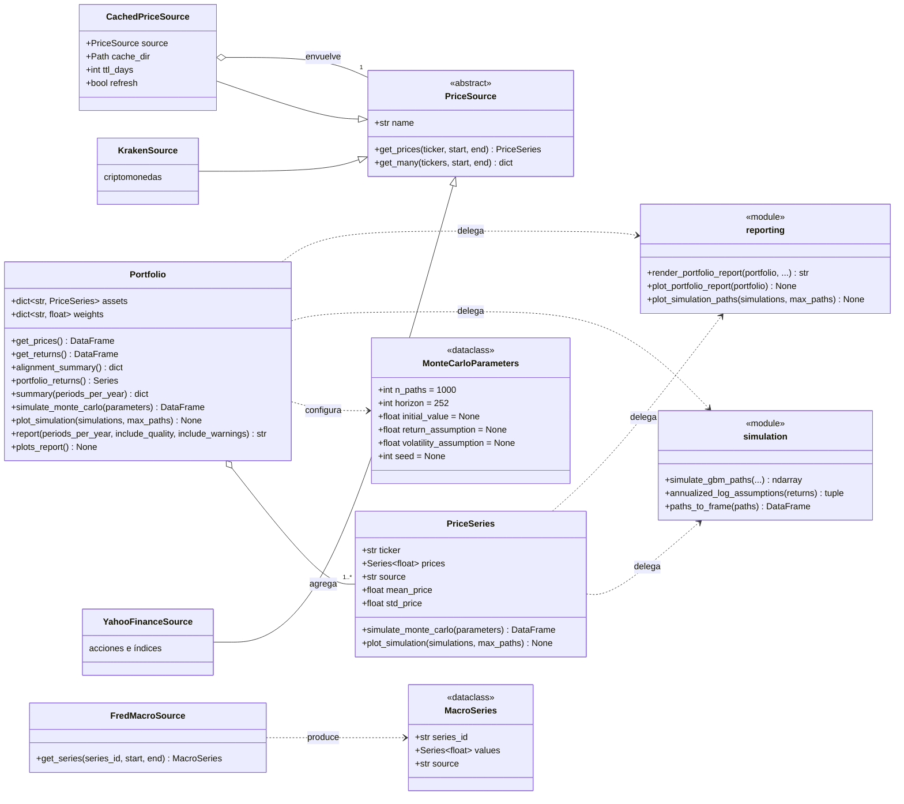
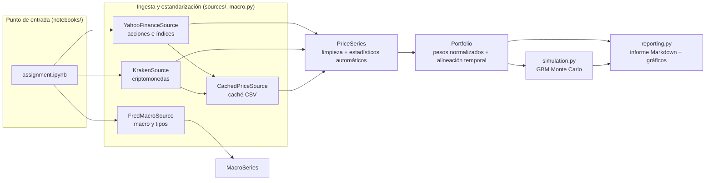

# Arquitectura de Quantfolio

Diagramas de la estructura de clases, las dependencias entre módulos y el flujo de datos del sistema. Los
diagramas están escritos en **Mermaid** (UML equivalente, renderizable directamente en GitHub); pueden editarse en
[FossFLOW](https://github.com/ai-8/fossflow), en [mermaid.live](https://mermaid.live) o en cualquier editor con
soporte de diagramas Mermaid.

## Diagrama de clases (UML)

**Lectura del diagrama.** `PriceSource` es el contrato común de la capa de ingesta: los proveedores concretos
(Yahoo Finance, Kraken) lo implementan y `CachedPriceSource` lo decora sobre cualquier otro proveedor, de forma
que la capa de análisis nunca depende de una API concreta. `PriceSeries` y `Portfolio` son las DataClasses del
modelo; `MonteCarloParameters` concentra la parametrización del motor `simulation.py`, y `reporting.py` contiene
los helpers de Markdown y gráficos que los métodos públicos delegan. `FredMacroSource`/`MacroSeries` cubren la
tipología de datos adicional (macroeconomía y tipos de interés).

## Flujo del sistema

**Flujo típico.** El cuaderno crea los proveedores y descarga las series (en lotes con `get_many()`, con caché
opcional). Cada proveedor normaliza su respuesta en `PriceSeries`, que limpia los datos y calcula sus estadísticos
al construirse. Con varias series se instancia `Portfolio`, que valida y normaliza los pesos y alinea los
calendarios. Sobre la cartera se calculan métricas, se genera el informe y los gráficos (`reporting.py`) y se lanza
la simulación Monte Carlo (`simulation.py`), cuyos resultados también se visualizan.

## Estructura de módulos

| Módulo | Responsabilidad |
|---|---|
| `quantfolio.models` | `PriceSeries` (limpieza, estadísticos automáticos) y utilidades numéricas. |
| `quantfolio.portfolio` | `Portfolio`: validación de pesos, alineación temporal, métricas, informe y Monte Carlo. |
| `quantfolio.simulation` | `MonteCarloParameters` y el motor GBM compartido por activo y cartera. |
| `quantfolio.reporting` | Generación del informe Markdown y de todas las visualizaciones. |
| `quantfolio.sources` | Contrato `PriceSource`, proveedores (Yahoo, Kraken) y caché CSV. |
| `quantfolio.macro` | `MacroSeries` y proveedor FRED para la tipología de datos adicional. |
| `quantfolio.constants` | Constantes compartidas (sesiones por año, umbrales de diagnóstico, etc.). |
